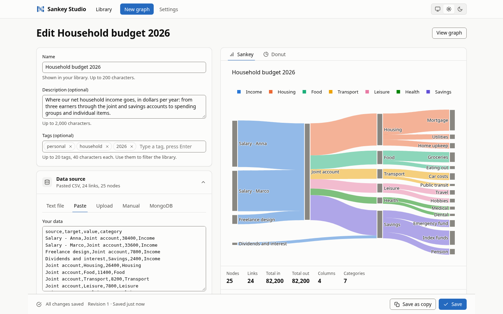
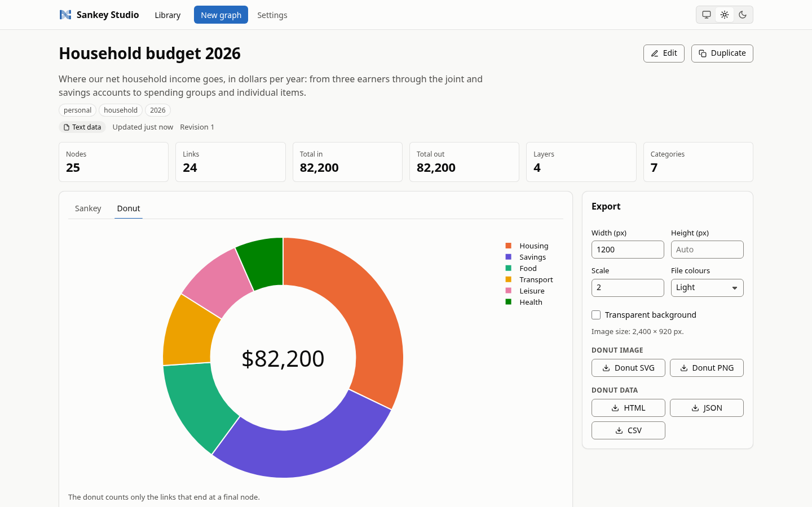
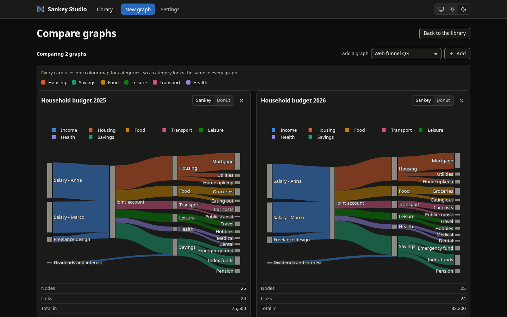

# Sankey Studio

Sankey Studio is a local web app for drawing and managing Sankey graphs. Paste or upload a CSV, point
it at a MongoDB collection or type the flows in by hand, and watch the diagram update as you edit.
Graphs are saved to a library on disk (or in MongoDB), can be compared side by side, and export to
SVG, PNG, HTML, JSON and CSV. Give the flows optional categories and the same data also becomes a
donut chart. It is a Python 3.14 FastAPI application with a vanilla JavaScript frontend (no build
step, no CDN), managed with uv, and it has no login: it listens on loopback by default and defends
itself in depth (see [Security model](#security-model)).



| Donut view of a categorised graph | Compare view, dark theme |
|---|---|
|  |  |

## Contents

* [Features](#features)
* [Quick start](#quick-start)
* [Using it](#using-it)
* [Security model](#security-model)
* [Development](#development)
* [Quality tooling](#quality-tooling)
* [Commit policy](#commit-policy)
* [Project layout](#project-layout)
* [Docs index](#docs-index)

## Features

* **Library** of saved graphs: create, edit, duplicate, delete, search, tag, sort, page, and import
  or export as a JSON bundle.
* **Live editor**: every change redraws the preview; unsaved-changes guard and optimistic
  concurrency (a stale save offers reload or save as copy).
* **Sources**: pasted or uploaded text (CSV, TSV, SankeyMATIC lines, JSON, NDJSON), files in a managed
  sources folder, read-only MongoDB collections (`find` or `aggregate`), and a manual table.
* **Transforms**: minimum link value, top-N links, hide and merge nodes, cycle handling, strict or
  lenient parsing.
* **Optional categories**: per-entry categories from the data, glob rules or explicit choices, a
  category legend, `category` colouring and a **donut chart** with three bases (all, initial,
  terminal). A graph without categories is a plain Sankey.
* **Compare** up to 12 graphs at once, with one shared colour per category.
* **Exports**: SVG and PNG (server-side through kaleido and Chrome, with a browser fallback), HTML
  (self-contained), JSON figure and CSV. The legend is part of the exported figure.
* **Settings page**: theme, MongoDB connections (passwords are never shown), storage backend with
  optional copy of existing graphs, limits.
* **Light and dark themes**, keyboard use, no external assets.
* **Safe by construction**: loopback bind, Host and CSRF checks, strict CSP, read-only MongoDB guard.

## Quick start

Requirements: [uv](https://docs.astral.sh/uv/) and Python 3.14 (uv installs it from `.python-version`
when it is missing). For SVG and PNG export, Chrome or Chromium must be installed; if it is not, run
`uv run plotly_get_chrome`. Without it, the UI falls back to the browser's own image download.

```bash
uv sync --all-extras      # install runtime and development dependencies
uv run sankey-studio serve
```

Then open <http://127.0.0.1:8765>. `make serve` does the same as the second command, and
`python -m sankey_studio` is equivalent to `sankey-studio`.

### Command line

```bash
uv run sankey-studio serve [--host HOST] [--port PORT] [--data-dir DIR] [--sources-dir DIR] \
                           [--allow-remote] [--allow-remote-writes]
```

| Flag | Environment variable | Default | Meaning |
|---|---|---|---|
| `--host HOST` | `SANKEY_HOST` | `127.0.0.1` | Address to bind. A non-loopback address needs `--allow-remote` |
| `--port PORT` | `SANKEY_PORT` | `8765` | Port to listen on (1 to 65535) |
| `--data-dir DIR` | `SANKEY_DATA_DIR` | `$XDG_DATA_HOME/sankey-studio` (`~/.local/share/sankey-studio`) | Holds `settings.json`, `graphs/` and the default sources folder |
| `--sources-dir DIR` | `SANKEY_SOURCES_DIR` | `<data-dir>/sources` | Folder of managed source files; must not equal or contain the data directory, `graphs/` or `settings.json` |
| `--allow-remote` | `SANKEY_REMOTE_MODE` | off | Accept a non-loopback bind. There is NO authentication; the app is read-only |
| `--allow-remote-writes` | `SANKEY_REMOTE_WRITES` | off | With `--allow-remote`: also allow changes to settings, files and graphs |
| (none) | `SANKEY_MONGO_URI` | unset | Seeds a connection named `default` when no `settings.json` exists yet |
| (none) | `SANKEY_ALLOWED_HOSTS` | `["localhost", "127.0.0.1", "[::1]"]` | JSON array of accepted `Host` headers |
| (none) | `SANKEY_LOG_LEVEL` | `info` | uvicorn log level: critical, error, warning, info, debug or trace |

Flags override environment variables. An invalid configuration prints where each problem is (never
the value, so credentials in `SANKEY_MONGO_URI` cannot leak) and exits with status 2 before anything
is bound. The server always runs one worker, because file locks and the export slot are per process.

**Remote mode.** `--host 0.0.0.0 --allow-remote` (or any other non-loopback address) prints a
"NO AUTHENTICATION" banner with the bound address and whether writes are enabled. By default every
endpoint that persists something answers 403 `read_only_mode`; previewing, viewing and exporting
still work. Add `--allow-remote-writes` to lift that restriction, only on a network you trust.

**The Host rule.** Requests are answered only for an accepted `Host` header; anything else gets
`400 Invalid host header` (this defeats DNS rebinding). The address you bind to is accepted
automatically, so `--host 127.0.0.2` serves `http://127.0.0.2:8765`. A wildcard bind such as
`0.0.0.0` has no usable `Host` of its own, so name every address clients will use. The variable
replaces the list, so include everything you need:

```bash
SANKEY_ALLOWED_HOSTS='["localhost", "127.0.0.1", "192.168.1.5"]' \
  uv run sankey-studio serve --host 0.0.0.0 --allow-remote
```

## Using it

### Data sources

The editor's source selector has five tabs: **Text file** (a file in the managed sources folder),
**Paste**, **Upload** (stores a file in the sources folder), **Manual** and **MongoDB**.

Text formats, detected automatically or chosen explicitly:

| Format | Example line | Notes |
|---|---|---|
| CSV / TSV | `Salary,Rent,1200,Housing` | Columns source, target, value and an optional category. Header optional; delimiter sniffed or set; a "category" header is picked up automatically |
| SankeyMATIC | `Salary [1200] Rent \| Housing` | `Source [value] Target`, optional `\| category`; blank lines and `//` comments ignored |
| JSON / NDJSON | `{"source":"Salary","target":"Rent","value":1200,"category":"Housing"}` | An array of objects, or one object per line |

Managed files must end in `.csv`, `.tsv`, `.txt`, `.json`, `.ndjson` or `.sankey`, and live in the
sources folder (upload limit 25 MB by default, adjustable in settings).

### Column mapping

For CSV and TSV, choose which column is the source, target, value and (optionally) category, by header
name or 0-based index. Numbers may carry thousands separators. Bad rows are skipped with a warning in
lenient mode and are errors in strict mode. A column you name that does not exist is always an error.

### MongoDB sources

Pick a configured connection, a database and a collection, then map dotted field paths to source,
target, value and (optionally) category. `find` takes a filter; `aggregate` takes a pipeline. The editor
lists databases and collections, shows sample documents and suggests fields. The row limit is 10,000 by
default (up to 1,000,000) with a per-query time limit. MongoDB is only ever read from here; see the
security model.

### Categories and the donut

Categories are optional everywhere. They come from the data (a category column, field or `| category`
suffix), from glob rules ("everything whose target matches `Rent*` is Housing") or from the entries
table, where you can set or clear one per source-target pair. Once at least one link is categorised,
the **Donut** tab appears in the viewer and editor, a category legend is shown, and the Sankey can be
coloured by category. The donut can count all links, only links that leave a source node (initial) or
only links that arrive at a sink node (terminal), and folds the smallest categories into an `Other`
slice.

### Exports

The export panel offers SVG, PNG, HTML page, JSON figure and CSV for the Sankey and the donut, with
width, height, scale, transparency and light or dark file colours. Image exports are capped at
36 million pixels, 5000 links and 2000 nodes, run one at a time and need Chrome or Chromium on the
server; otherwise the UI uses the browser's own download.

### Connections and storage

The settings page manages named MongoDB connections. Passwords are stored in `settings.json` (mode
0600) and are never shown again: the form displays "(unchanged)". Graphs are stored in one of two
backends:

* **Files** (default): one `<id>.json` per graph in `<data-dir>/graphs/`, written atomically.
* **MongoDB**: collection `sankey_studio_graphs` in a database you choose (default `sankey_studio`).
  The connection needs write permission on that database. Switching backends can copy the existing
  graphs; the old store is never deleted.

For a project-local MongoDB on `127.0.0.1:27117` run `make mongo-up` (needs Docker); `make mongo-down`
stops it.

## Security model

There is no login, so the app protects itself:

* **Loopback by default.** It binds to `127.0.0.1`. Any other address needs `--allow-remote`, which is
  read-only unless `--allow-remote-writes` is also given, and prints a loud warning banner.
* **Host, Origin and CSRF checks.** Only accepted `Host` headers are served. A write (POST, PUT,
  PATCH, DELETE) is accepted only from the app's own origin (`Sec-Fetch-Site: same-origin` or `none`,
  or an `Origin` that matches scheme, host and port). A client that sends neither header may only send
  `application/json`, never a form or a file upload. `Origin: null` and other ports are refused. No
  CORS headers are sent.
* **Content-Security-Policy and friends.** Scripts and styles come only from the app itself (no
  inline scripts, no CDN), framing is forbidden, and responses carry `nosniff`, a same-origin
  referrer policy and `no-store`. Downloads are attachments sandboxed by CSP.
* **Read-only MongoDB.** Filters and pipelines run through an allow-list guard that refuses writes,
  code execution and cross-database reads; the `admin`, `local`, `config` and `system.*` namespaces are
  never readable; connection strings with options that read local files or weaken TLS are rejected.
  The only code that writes to MongoDB is the optional graph store.
* **Path containment.** Source files are confined to the sources folder: no symlinks, no traversal, a
  fixed extension allow-list, regular files only, sanitised upload names and a streamed size cap.
* **Masked URIs, secrets never returned.** The API returns `uri_masked` and `has_secret`, never a
  connection string. Logs and errors carry only the connection name. A masked placeholder can never
  overwrite a stored secret.
* **Remote mode is read-only** unless you opt in; while it is read-only, the settings page hides
  connection hosts and user names.
* **Output encoding.** User text is escaped in every figure label, HTML export and CSV cell (formula
  injection guard), and the frontend never writes HTML from strings.

Details and the reasoning are in [docs/architecture.md](docs/architecture.md#security-design) and
[docs/decisions.md](docs/decisions.md).

## Development

```bash
make sync     # uv sync --all-extras
make hooks    # enable the versioned git hooks (once per clone)
make check    # lint, typecheck, caps, cov, memray
```

| Target | What it does |
|---|---|
| `make sync` | `uv sync --all-extras` |
| `make lint` | `ruff check` and `ruff format --check` on `src tests scripts` |
| `make format` | `ruff check --fix` and `ruff format` |
| `make typecheck` | `mypy` in strict mode |
| `make caps` | Code caps (file 500, function 50, class 300, params 4, nesting 4), ratcheted against `.code-caps-baseline.json`, run on Python 3.14 |
| `make test` | Unit tests: `pytest -m "not memory and not e2e"` |
| `make e2e` | End-to-end tests: the real app and real Chrome (`pytest -m "e2e and not mongo"`) |
| `make e2e-mongo` | The same flows against a real MongoDB (needs `SANKEY_TEST_MONGO_URI`) |
| `make cov` | Unit tests with coverage; fails below 100% line and branch of `src/sankey_studio` |
| `make memray` | Memory-budget tests (pytest-memray) |
| `make profile` | Whole-pipeline memory profile and flamegraph in `.memray/` |
| `make mutate` | mutmut mutation testing of `src/sankey_studio` |
| `make mutate-gate` | Fails when the mutation score is below 90 |
| `make semgrep` | Semgrep with the project rules and registry packs (Docker) |
| `make semgrep-test` | Tests of the Semgrep rules (Docker) |
| `make trivy` | Trivy scan of `uv.lock`, secrets, misconfigurations and licences (Docker) |
| `make qodana` | Qodana Ultimate Plus inspection (needs `QODANA_TOKEN`) |
| `make security` | `semgrep-test`, `semgrep`, `trivy` |
| `make gitnexus` | Refresh the GitNexus code-intelligence index (`gitnexus analyze --pdg`) |
| `make hooks` | `git config core.hooksPath .githooks` |
| `make check` | `lint`, `typecheck`, `caps`, `cov`, `memray` |
| `make ci` | `check` plus `security` |
| `make full` | `ci` plus `mutate`, `mutate-gate`, `qodana` |
| `make serve` | `uv run sankey-studio serve` |
| `make mongo-up` | Start the project-local MongoDB (Docker) on `127.0.0.1:27117` |
| `make mongo-down` | Stop it |
| `make clean` | Remove caches and reports |

There is also `make gitnexus-status`.

**Gates.** Coverage must be 100% line and branch of `src/sankey_studio`. The mutation score must be at
least 90. Code caps are 500 lines per file, 50 per function, 300 per class, 4 parameters and nesting 4;
the baseline `.code-caps-baseline.json` is empty and is a ratchet that may only shrink, so fix a
violation instead of recording it. Unit tests use mongomock. Real-MongoDB tests (`@pytest.mark.mongo`)
and `make e2e-mongo` run only when `SANKEY_TEST_MONGO_URI` is set, for example
`SANKEY_TEST_MONGO_URI=mongodb://127.0.0.1:27117 make e2e-mongo` after `make mongo-up`. The compose
MongoDB binds `127.0.0.1:27117` so it never collides with another local MongoDB.

Python 3.14 syntax such as `except A, B:` (PEP 758) is used, so tools that parse the sources need a
3.14 interpreter; `make caps` runs `uv run --no-project --python 3.14 python scripts/check_code_caps.py`
for that reason.

## Quality tooling

* **ruff** (all rules, formatter), **mypy** in strict mode, **pytest** with warnings as errors.
* **memray** memory budgets (`make memray`) and a whole-pipeline profile (`make profile`).
* **mutmut** mutation testing with a score gate.
* **Semgrep** with custom rules for the project's invariants (MongoDB writes only in the graph store,
  no unsafe HTML or JavaScript sinks, no secrets in logs, no outbound HTTP, ...), run in Docker.
* **Trivy** for dependencies, secrets, misconfigurations and licences, run in Docker.
* **Qodana Ultimate Plus**: needs a `QODANA_TOKEN` in a local `.env`. Copy `.env.example` to `.env`
  and fill the value in yourself; the file is gitignored, and `scripts/qodana.sh` reads the token
  into its own process without printing it.
* **GitNexus** code-intelligence index (`make gitnexus`) for impact analysis before edits.

More in [docs/quality.md](docs/quality.md).

## Commit policy

Enable the hooks once per clone with `make hooks`. `pre-commit` runs the code caps. `commit-msg`
enforces:

```
<type>(<scope>)!: <subject>
```

* **type**: `feat`, `fix`, `chore`, `docs`, `refactor`, `perf`, `test`, `build`, `ci`, `style`
* **scope** (optional, comma separated): `core`, `sources`, `mongo`, `storage`, `settings`, `graph`,
  `render`, `export`, `web`, `ui`, `cli`, `security`, `e2e`, `tests`, `deps`, `tooling`, `docs`,
  `hooks`, `ci`, `release`
* `!` before the colon marks a breaking change
* subject at most 150 characters; body at most 10 lines of at most 150 characters
* commits authored by an AI assistant start with the robot emoji, for example
  `🤖 fix(sources): reject path traversal in text files`
* no AI attribution in messages: no `Co-Authored-By` trailer and no assistant or vendor names

## Project layout

```
src/sankey_studio/
  cli.py, __main__.py   command line (argparse -> BootstrapConfig -> uvicorn)
  config.py             BootstrapConfig: SANKEY_* settings, loopback and remote-mode rules
  errors.py             domain errors with stable codes
  util.py               URI masking, category identity
  models/               pydantic specs (sources, transform, style, graphs, settings), SankeyGraph
  mongo.py              cached MongoDB client registry with per-connection concurrency slots
  mongo_safety.py       read-only guard for filters, pipelines, names and URIs
  sources/              text (formats/, files/), MongoDB (source, extract, inspect, sample,
                        suggest) and manual data sources
  graph/                build_graph: intern, categories, pairs, cycles, layers, assemble
  render/               Sankey and donut figures, legend, colours, palette, tables, exports
  storage/              file and MongoDB graph stores, settings.json, bundles, migration
  services.py           Services: wires settings, clients, storage and source context
  bundle.py             RenderBundle: everything a page needs to draw one graph
  pipeline.py           draft -> graph -> bundle, with a small result cache
  web/                  FastAPI app: middleware, security, routers/, schemas/, templates/, static/
scripts/                code caps, mutation gate, memory profile, Semgrep/Trivy/Qodana runners
tests/                  unit tests mirroring src/, contracts/, e2e/
docs/                   project documentation and screenshots
.semgrep/rules/         custom Semgrep rules and their tests
.githooks/              pre-commit and commit-msg hooks
```

## Docs index

* [docs/architecture.md](docs/architecture.md): product, modules, data model, pipeline, storage,
  rendering, security design
* [docs/api.md](docs/api.md): the HTTP API contract, error envelope, routes, page contexts
* [docs/ui.md](docs/ui.md): pages, states, `data-testid` reference, DOM wait signals
* [docs/quality.md](docs/quality.md): gates, caps, coverage, mutation, scanners, commit policy
* [docs/decisions.md](docs/decisions.md): architecture decision records
* [docs/e2e.md](docs/e2e.md) (end-to-end tests)
* [CHANGELOG.md](CHANGELOG.md): release notes
